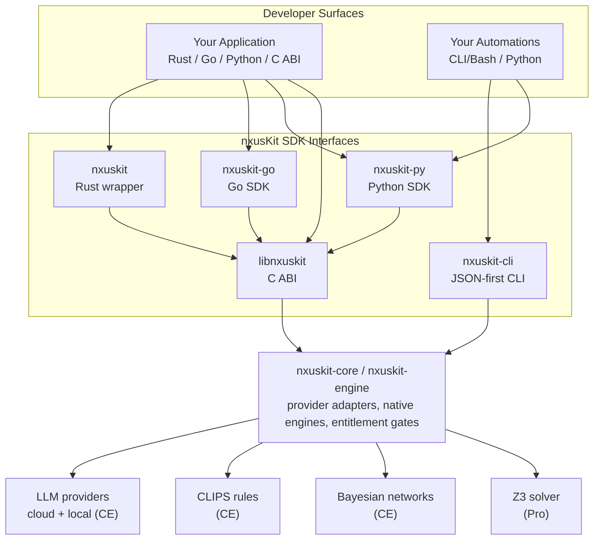

# nxusKit

**Generative AI, rules, and reasoning for Rust, Go, Python, and the CLI.**

Community Edition includes LLM adapters, CLIPS rules, and Bayesian inference. The v2.0.0 platform bundles also include Pro Solver for developers with an eligible license.

[](https://github.com/nxus-SYSTEMS/nxusKit/actions)
[](LICENSE-MIT)


Current Rust minimum: **1.94** for source builds and Rust SDK consumers. Earlier
compilers are no longer supported. Historical package/test records retain their
actual compiler identities; this declaration does not rebuild or requalify them.


**[Documentation](https://docs.nxus.systems/nxuskit/)** · **[Getting Started](https://docs.nxus.systems/nxuskit/getting-started/installation/)** · **[Examples Docs](https://docs.nxus.systems/nxuskit/examples/)** · **[Examples Repo](https://github.com/nxus-SYSTEMS/nxusKit-examples)** · **[Website](https://nxus.systems)**

> **v2.0.0 availability:** Community Edition works without an SDK license. New Pro
> purchases remain paused.

---

## Get Started

Download and verify the [v2.0.0 SDK archive](https://github.com/nxus-SYSTEMS/nxusKit/releases/tag/sdk-v2.0.0)
for Linux x86_64, macOS ARM64, or Windows x86_64. The same bundle runs CE
without a token and requires a valid v2 Pro entitlement for Pro Solver.
Follow the [installation guide](docs/user/getting-started.md) and try the
[local first call](docs/user/first-call.md). Upgrading from v1.0.5? See the
[upgrade guide](docs/user/upgrade-path.md#migrate-from-v105-to-v200).

Use the language bindings that match your SDK version:

| Language | Package | Install |
|----------|---------|---------|
| **Rust** | [nxuskit](packages/nxuskit/) | Path dependency from SDK bundle |
| **Go** | [nxuskit-go](packages/nxuskit-go/) | Use the matching bundle or source binding |
| **Python** | [nxuskit-py](packages/nxuskit-py/) | Use the matching bundle or source binding |
| **C ABI** | Native library and headers | Use the matching bundle or build CE from source |

### What changed in v2.0.0

Use the versioned **1.1 workflow contract** to validate pipeline definitions
and inspect structured stage outcomes, canonical hashes, and artifact history.
The CLI's 1.1 LLM runner uses the built-in loopback adapter for local exercises.
Use the SDK provider APIs or CLI `call` for real provider requests. External
action stages report that your application must perform the action. See the
[1.1 workflow example](docs/user/cli-input-reference.md#version-11-workflow-contract).

Streaming callers can now distinguish the end of a response from the provider's
reason for stopping. Use the completion helper where available and handle
errors separately. Rust and Go callers with affected struct literals may need
to change code. The [upgrade guide](docs/user/upgrade-path.md#migrate-from-v105-to-v200)
lists the changes by language and explains how to test v2 alongside v1.0.5.

### Build Community Edition From Source

The public repository is intended to be buildable as Community Edition source
without internal nxusKit infrastructure:

```bash
git clone https://github.com/nxus-SYSTEMS/nxusKit.git
cd nxusKit
make build
make qa
```

`make build` compiles the CE native library, checks the Rust wrapper, builds the
Go SDK, and byte-compiles the Python package. `make qa` adds the source-build
QA checks that are safe for a fresh public checkout.

### CLI / Shell Automation

nxusKit includes `nxuskit-cli`, a JSON-first control plane for shell automation, CI, and multi-engine reasoning workflows. The CLI exposes supported SDK operations through machine-readable input and output.

```bash
# Local LLM fixture with structured output
echo '{"prompt":"hello","provider":"loopback","model":"echo"}' \
  | nxuskit-cli call --input - --format json

# Constraint solving (Pro; implementation not shipped in public CE)
nxuskit-cli solver solve --input problem.json --format json

# What-if analysis with base vs. assumed comparison (Pro)
nxuskit-cli solver what-if --problem base.json --assume 'x > 5' --compare --format json

# Bayesian network parameter learning + evidence validation (v0.9.4)
nxuskit-cli bn learn --input bn_learn.json --format json     # learn CPDs from CSV; output is BIF-exportable
nxuskit-cli bn evidence --input observations.json --format json

# List available providers
nxuskit-cli provider list --format json

# CLIPS session management
nxuskit-cli clips session create --input rules.json --format json
nxuskit-cli clips session list --format json

# Multi-engine pipeline
nxuskit-cli pipeline run --input workflow.yaml --format json

# Shell completions (bash / zsh / fish)
nxuskit-cli completions bash >> ~/.bashrc
nxuskit-cli completions zsh > ~/.zfunc/_nxuskit-cli
nxuskit-cli completions fish > ~/.config/fish/completions/nxuskit-cli.fish
```

The CLI is bundled in the [SDK release archive](https://github.com/nxus-SYSTEMS/nxusKit/releases). See the [CLI Input Format Reference](https://docs.nxus.systems/nxuskit/reference/cli-reference/) for all commands and input schemas.

Looking for runnable examples? Start with the **[nxusKit examples documentation](https://docs.nxus.systems/nxuskit/examples/)** or open the **[nxusKit Examples](https://github.com/nxus-SYSTEMS/nxusKit-examples)** repository — 30+ examples across Rust, Go, Python, and CLI/Bash covering streaming, vision, tool calling, CLIPS rules, constraint solving, and more. Each example is labeled by edition so developers can see what works with Community Edition and what requires Pro before they run it.

---

## Quick Example

Stream a response through a configured provider. Models and capabilities depend on the provider:

**Python**
```python
import nxuskit

provider = nxuskit.Provider.openai()  # or .claude(), .ollama(), .xai(), .groq(), ...
for chunk in provider.chat_stream([nxuskit.Message.user("Tell me a story")]):
    print(chunk.delta, end="", flush=True)
```

**Go**
```go
resp, _ := nxuskit.Completion(ctx, "gpt-4o", "Tell me a story")
fmt.Println(resp.Content)
```

**Rust**
```rust
let request = ChatRequest::new("gpt-4o").with_message(Message::user("Tell me a story"));
for chunk in provider.chat_stream(request)? {
    print!("{}", chunk.delta);
}
```

### Token logprobs (unary chat since v0.9.3; streaming since v0.9.4)

First-class `logprobs` / `top_logprobs` request and typed response across
Rust, Python, and the C ABI. Engine warn-and-drops on unsupported
providers (no silent tunneling through `provider_options`). Streaming
logprobs (`StreamChunk.logprobs`) shipped in v0.9.4 - see
[`logprobs-migration.md`](sdk-packaging/docs/logprobs-migration.md).

**Rust**
```rust
let request = ChatRequest::new("gpt-5.4")
    .with_message(Message::user("Score the next token."))
    .with_logprobs(true)
    .with_top_logprobs(5);

let response = provider.chat(request)?;
if let Some(lp) = response.logprobs {
    let token = &lp.content[0];
    println!("{} (logprob {})", token.token, token.logprob);
    for alt in &token.top_logprobs {
        println!("  alt: {} ({})", alt.token, alt.logprob);
    }
}
```

**Python**
```python
from nxuskit import ChatRequest

req = ChatRequest(
    model="gpt-5.4",
    messages=[{"role": "user", "content": "Score the next token."}],
    logprobs=True,
    top_logprobs=5,
)
# Response logprobs decode into typed LogprobsData / TokenLogprob / TopLogprob
```

### Activate an existing eligible Pro entitlement

Use the matching v2.0.0 bundle and a valid v2 Pro entitlement for Solver.
Login and activation contact the licensing service. The SDK validates the
installed token locally when running entitled operations.

```bash
# One-time device-auth login
nxuskit-cli license login

# Activate the entitlement shown in My Products
nxuskit-cli license activate --key "$NXUSKIT_PURCHASE_ID" --accept-eula --json

# Inspect the current license + endpoint diagnostics
nxuskit-cli license status --json
```

See [`sdk-packaging/docs/license-activation-guide.md`](sdk-packaging/docs/license-activation-guide.md)
for the full activation flow. Inspect the returned license fields and verify the intended Solver operation.

---

## Community Edition and Pro

nxusKit SDK uses a dual-edition model.

The public `nxusKit` repository contains nxusKit SDK Community Edition, which is free and open source. CE is not a trial, teaser, or time-limited evaluation; it is intended to remain useful on its own. We do not move released CE features behind the Pro paywall, and code released as CE remains available under its open-source license.

Community Edition is useful on its own without Pro. The public `nxusKit-examples` repository labels examples by edition, so developers can see which workflows run with CE alone and which require Pro.

The binary SDK bundles also contain proprietary Pro capabilities. Download
access does not grant a Pro entitlement. Solver is the initial supported Pro
capability; other compiled capabilities are not launch support promises.

---

## Features

- **Cloud and local LLM providers (CE)** — Claude, OpenAI, Ollama, xAI Grok, Groq, Mistral, Fireworks, Together, OpenRouter, Perplexity, LM Studio, and more
- **Per-Request Model Override (CE)** — Switch models on any `chat()` call without creating new provider instances
- **Streaming (CE)** — First-class SSE and NDJSON streaming with `is_final()` completion detection
- **Tool Calling (CE)** — Function definitions, tool choice strategies, response deserialization on supported providers
- **Vision/Multimodal (CE)** — Image inputs via URL, base64, or file path with auto-detected MIME types
- **CLIPS Rule Engine (CE)** — Session lifecycle, fact assertion, rule execution, and rule-backed validation
- **Bayesian Networks (CE)** — Structure learning, parameter estimation, inference with evidence
- **Z3 Constraint Solver (Pro)** — Variables, constraints, objectives, push/pop scoping, streaming solve
- **Model Discovery (CE)** — `list_models()` with vision detection, modality introspection, capability metadata
- **Retry & Rate Limiting (CE)** — Configurable backoff, adaptive rate limiting, per-provider error handling
- **Language bindings** — Rust, Go, and Python APIs with shared concepts; capabilities vary by binding and provider.

---

## Architecture

nxusKit is designed to sit between your application or automation layer and a set of LLM, symbolic, probabilistic, and Pro solver-backed engines.



Language SDKs provide idiomatic APIs, mock/loopback testing utilities, and FFI-backed access to native engines where needed. `nxuskit-cli` exposes the same engine family as JSON-first commands for scripts, CI, and shell pipelines. See [ARCHITECTURE.md](ARCHITECTURE.md) for developer integration patterns, including LLM routing recipes, audit loops, and creativity-engine designs.

---

## Testing

Use `make qa` in the public Community Edition checkout and see the
[contribution guide](CONTRIBUTING.md) for language-specific checks.

---

## Supported Providers

| Provider / Engine | Edition | Auth | Streaming | Vision | Purpose |
|-------------------|---------|------|-----------|--------|---------|
| **Claude** | CE | API Key | SSE | Yes | Chat/Completion |
| **OpenAI** | CE | Bearer | SSE | Yes | Chat/Completion |
| **Ollama** | CE | None | NDJSON | Yes | Local Inference |
| **xAI Grok** | CE | API Key | SSE | Yes | Chat/Completion |
| **Groq** | CE | API Key | SSE | No | Fast Inference |
| **Mistral** | CE | API Key | SSE | Yes | Chat/Completion |
| **Fireworks** | CE | API Key | SSE | Yes | Open-weight models |
| **Together** | CE | API Key | SSE | Yes | Open-weight models |
| **OpenRouter** | CE | API Key | SSE | Yes | Multi-provider routing |
| **Perplexity** | CE | API Key | SSE | No | Search-augmented |
| **LM Studio** | CE | Optional | SSE | Yes | Local Inference |
| **CLIPS** | CE | None | Custom | No | Expert Systems |
| **Bayesian Net** | CE | None | JSON | No | Probabilistic Inference |
| **Z3 Solver** | Pro | None | JSON | No | Constraint Solving |

---

## Examples

The **[nxusKit examples documentation](https://docs.nxus.systems/nxuskit/examples/)** catalogs 30+ runnable examples, with source available in the **[nxusKit-examples](https://github.com/nxus-SYSTEMS/nxusKit-examples)** repository:

| Category | Examples |
|----------|----------|
| **Patterns** | Streaming, retry, cost routing, token budgets, structured output |
| **Vision** | Image analysis, multimodal chat |
| **Tool Calling** | Function definitions, tool choice, agent loops |
| **CLIPS** | Rule loading, fact assertion, LLM+rules hybrid |
| **Solver** | Constraint satisfaction, what-if analysis (`--compare`), optimization (Pro) |
| **Bayesian** | Structure learning, inference, evidence propagation (CE) |

Check each example for supported languages and prerequisites.

---

## Support

Report product issues through [GitHub Issues](https://github.com/nxus-SYSTEMS/nxusKit/issues).
Include the SDK version, operating system, language, and a minimal reproduction.
For initial Pro support scope, see [Community and Pro](docs/user/tier-comparison.md).

---

<!-- ACKNOWLEDGEMENTS START -->
Built with gratitude for the open-source projects that make nxusKit possible.
See [ACKNOWLEDGEMENTS.md](ACKNOWLEDGEMENTS.md) for a curated list of key projects.
<!-- ACKNOWLEDGEMENTS END -->

---

## License

nxusKit is dual-licensed under MIT and Apache 2.0. See [LICENSE-MIT](LICENSE-MIT) and [LICENSE-APACHE](LICENSE-APACHE).

Copyright 2025-2026 nxus.SYSTEMS LLC.
